# Cohub: dataset and model versioning for sports-outplay-saliency-vinet

Cohub (CLI `cohub` v1.0.4, server `https://cohub.dev.eka.amagi.tv`) versions
datasets as LakeFS repos and models as immutable MLflow versions. This repo
uses it for one dataset repo and one model, both named
`sports-outplay-saliency-vinet`, owner `video-intelligence`.

```mermaid
flowchart LR
  linode[Linode split] --> stage["scripts/stage_outplay_dataset.py --execute\n(one-time, dry-run first)"]
  stage --> importTag["scripts/cohub_dataset_import.sh\ncohub datasets import, tag v1"]
  importTag --> mount["goofys mount of the v1 prefix\n(VM, --split_root)"]
  mount --> train["train.py\n--dataset_version check"]
  train --> best[local checkpoints/best.pt]
  best --> release["make cohub-release RUN_DIR=..."]
  release --> model["sports-outplay-saliency-vinet\nversion N, variant base"]
```



Nothing here promotes a model to `prod` (a promoted model cannot be
deleted), and nothing here runs the real multi-object upload or `cohub`
registration commands automatically -- those are explicit, operator-run
steps, listed at the end of this doc.

## 1. Install the `cohub` CLI (v1.0.4)

Download the matching release zip, named `cohub-v1.0.4-<os>-<arch>.zip`
(containing a `cohub-v1.0.4-<os>-<arch>/` directory with the `cohub` binary
and a README), then put the binary on `PATH`:

- **Local (this laptop, macOS arm64):** `cohub-v1.0.4-darwin-arm64.zip`
- **VM (training host, Linux x86_64):** `cohub-v1.0.4-linux-amd64.zip`

```bash
unzip cohub-v1.0.4-<os>-<arch>.zip
install -m 0755 cohub-v1.0.4-<os>-<arch>/cohub /usr/local/bin/cohub
cohub --version
```

Then log in once per machine:

```bash
# Local, with a browser:
cohub auth login

# VM, over SSH (no local browser):
cohub auth login --paste
```

`make cohub-release` shells out to whatever `cohub` resolves to on `PATH`
(override with `COHUB=/path/to/cohub`). `train.py` does the same only when
`--dataset_version` is set. If `cohub` is missing in those cases, both fail
fast with a message pointing back to this section instead of hanging or
silently skipping the check. A training run with no `--dataset_version`
never calls `cohub`.

## 2. Stage and import the dataset (one-time per version)

The split lives on Linode and is normally read through a goofys mount; the
Cohub import reads an AWS S3 prefix, so the bytes are copied into
`s3://aiml-sports-data` first. This happens **once per dataset version**,
not on every training run.

1. **Dry run the upload** (default; no AWS calls that write anything):

   ```bash
   .venv/bin/python3 scripts/stage_outplay_dataset.py
   ```

   This validates the local split (manifest + every window's 32
   images/32 maps) and prints the object count and total bytes. Pass
   `--split-root` if the mount isn't at the default VM path.

2. **Upload for real**, from the machine with the goofys mount (the VM) and
   the short-lived SSO session in the repo's `.env`:

   ```bash
   .venv/bin/python3 scripts/stage_outplay_dataset.py --execute
   ```

   This reads only the `[profile]` header out of `.env` -- never the
   `aws_access_key_id`/`aws_secret_access_key`/`aws_session_token` values,
   which are never printed, logged, or committed (`.env` is gitignored) --
   and points the AWS CLI at that file via `AWS_SHARED_CREDENTIALS_FILE`.
   It refuses to run if `s3://aiml-sports-data/sports-outplay-saliency-vinet/v1/`
   already has objects, so it can't overwrite an already-imported tag. A
   later dataset version uploads to a sibling prefix: `--version v2`.

3. **Import into Cohub** (after `cohub auth login`, on the VM `cohub auth
   login --paste`):

   ```bash
   scripts/cohub_dataset_import.sh v1
   ```

   This runs `cohub datasets create`, `cohub datasets import --tag v1`, and
   `cohub datasets card generate`, all for `sports-outplay-saliency-vinet`.
   `cohub datasets import` is a metadata pointer into LakeFS, not a copy --
   it only works once the prefix above actually has the bytes.

The resulting lineage URI for training is:

```
lakefs://sports-outplay-saliency-vinet/v1
```

(repo, then tag -- **not** `lakefs://datasets/...`).

## 3. Train against a dataset version

`--dataset_version` is optional. With it omitted, `train.py` does not call
`cohub` and reads whatever `--split_root` points at. The launch script
defaults to the Linode goofys mount
`/home/nitesh_sawadia/mnt/ml-fanpulse/sports_saliency/vinet_outplay/split_stride8`,
the stride-8 Linode split. See
[`ViNet_S/README.md`](../ViNet_S/README.md) for that runbook.

To pin a run to this dataset:

- Mount `s3://aiml-sports-data/sports-outplay-saliency-vinet/v1/` with
  goofys on the VM and pass it as `--split_root`. Frame reads stay on that
  mount; Cohub is only the version check, not the file server.
- Pass `--dataset_version lakefs://sports-outplay-saliency-vinet/v1`. At
  startup `train.py` (`ViNet_S/dataset_version.py`) downloads that tag's
  `split_manifest.json` with `cohub datasets download` and aborts unless
  its sha256 matches the mounted `split_manifest.json`. The URI is logged
  to MLflow params and to the run's `config/args.json`.
- `--resume` of a pinned run must pass the same `--dataset_version`;
  `train.py` reads it back from that run's `args.json` and exits if the
  flag is missing or disagrees. A run that never recorded one resumes
  without the flag. Resuming never registers a model with Cohub.

## 4. Release a trained model

`make cohub-release RUN_DIR=...` is explicit -- it is never called from the
training loop. Registration is not idempotent: a timed-out retry can create
an extra, undeletable version, so this never retries automatically.

```bash
make cohub-release RUN_DIR=/home/nitesh_sawadia/vinet_s/runs/<run-name>
```

What it does, in order (see the root [`Makefile`](../Makefile)):

1. Reads `dataset_version` from the run's `config/args.json`, and val loss /
   val CC / val SIM from `checkpoints/best.pt`
   (`scripts/read_run_metadata.py`).
2. Exports `best.pt`'s `model` state dict only -- no optimizer, no epoch --
   to the gitignored `.cohub_release/sports-outplay-saliency-vinet.pt`
   (`scripts/export_release_weights.py`). `best.pt` itself is untouched and
   stays the full training bundle for `--resume`.
3. `cohub models register --name sports-outplay-saliency-vinet --owner
   video-intelligence --dataset-version <uri> --git-sha "$(git rev-parse
   HEAD)" --intended-use "..." --file .cohub_release/...pt --flavor pytorch
   --input-schema schemas/outplay_input_schema.json --output-schema
   schemas/outplay_output_schema.json`, capturing the server-allocated
   version from `cohub -o json`. The description (set once, below) is
   frozen forever by the first registration of this model name. **On
   failure, it runs `cohub models get sports-outplay-saliency-vinet` and
   stops -- it does not retry.** Check that output before deciding whether
   a fresh `make cohub-release` is safe.
4. `cohub models card generate` with those metrics, the dataset URI
   (`training_dataset`), and the preprocessing from
   [`ViNet_S/outplay_dataset.py`](../ViNet_S/outplay_dataset.py)
   (`docs/outplay_preprocessing.txt`).
5. `cohub variants publish sports-outplay-saliency-vinet <version> base
   --wait`. No `cohub models promote`; that is a separate, deliberate
   operator decision.

The frozen first-registration description is:

> ViNet-S finetuned on sports outplay saliency, 32-frame 224x384 clips.

Input/output contracts (`schemas/outplay_*_schema.json`): a float32 clip
`[32, 3, 224, 384]`, ImageNet-normalized, in; a float32 map `[224, 384]` in
`[0, 1]`, out.

To check that a version is really tied to the tag it claims:

```bash
cohub lineage sports-outplay-saliency-vinet <version>
```

Retraining on a new dataset version (`v2`, ...) is: stage + import `v2`
(section 2, with `--version v2`), train with `--dataset_version
lakefs://sports-outplay-saliency-vinet/v2`, then `make cohub-release` again.
That creates the next version of `sports-outplay-saliency-vinet`, pointing
at the new tag.

## 5. Release sports-salient-viewport (ONNX + paired PT)

Sports-agnostic 9:16 viewport head on pretrained ViNet-S. I/O contract:
[`docs/INFERENCE_CONTRACT.md`](INFERENCE_CONTRACT.md). Schemas:
[`schemas/viewport_input_schema.json`](../schemas/viewport_input_schema.json),
[`schemas/viewport_output_schema.json`](../schemas/viewport_output_schema.json).

Cohub names (cross-tagged):

- `sports-salient-viewport` — flavor `onnx`
- `sports-salient-viewport-pt` — flavor `pytorch`

Frozen description on first register:

> ViNet-S (Pretrained) with in-graph ImageNet normalize and 9:16 saliency-mass viewport head; sports-agnostic outplay clips at 32x224x384.

Dry-run first (export + CUDA regress still run; S3/Cohub argv are printed only):

```bash
make release-onnx \
  CHECKPOINT=/home/nitesh_sawadia/vinet_s/weights/vinet_s_dhf1k.pt \
  DRY_RUN=1
```

Live release (no auto-retry on register):

```bash
make release-onnx \
  CHECKPOINT=/home/nitesh_sawadia/vinet_s/weights/vinet_s_dhf1k.pt
```

Order: `export-viewport` → `regress-viewport` → `upload-viewport-s3` →
register ONNX + PT (card + `variants publish base`). S3 object:

`s3://aiml-sports-data/onnx_repo/outplay/salient_viewport/co_<git7>_<ts>.onnx`

Subtargets (`export-viewport`, `regress-viewport`, `upload-viewport-s3`,
`register-viewport-onnx`, `register-viewport-pt`) are callable alone.
`DATASET_VERSION` defaults to `NA`.

VM extras for this path: `pip install onnx onnxruntime-gpu` (or
`onnxruntime` if CUDA EP is unavailable). Export/regress need a CUDA GPU.

This path is independent of `make cohub-release` (outplay saliency `.pt`).

## What this implementation does *not* do

- It never runs the real multi-object upload (`stage_outplay_dataset.py
  --execute`) or live `cohub datasets import` / `cohub models register`
  against the server -- those require the goofys mount (VM-only) and a
  logged-in `cohub` session, and registration isn't idempotent.
- It never calls `cohub models promote`.
- `make release-onnx DRY_RUN=1` never writes to S3 or Cohub; a live
  `make release-onnx` is still an explicit operator step on the VM.

## Verification done without touching the live server

- `scripts/*.py` and `tests/*.py`: `python3 -m py_compile`, `--help`, and
  dry runs against fixture split trees and fixture `.env`-style files (no
  network calls).
- `scripts/export_release_weights.py` / `scripts/read_run_metadata.py`:
  unit tests in `tests/test_cohub_release.py` build a tiny torch state
  dict, save it in `train.py`'s checkpoint-bundle format, and check the
  weights-only export and metric reads against it.
- `ViNet_S/dataset_version.py`: unit tests in `tests/test_dataset_version.py`
  cover the lakefs URI parser, the sha256 check (with `cohub` faked via a
  monkeypatched `subprocess.run`), and the resume-disagreement check.
- `Makefile`'s `cohub-release` target: run end-to-end against a fixture run
  directory with a stub `cohub` script on `PATH` that validates every
  required flag is present and returns canned `-o json` output, confirming
  the register/card/publish command construction and version-capture logic
  without hitting the real server. Also confirmed it fails fast with an
  install pointer to this doc when `cohub` is absent from `PATH`.

Run every Python unit test with:

```bash
.venv/bin/python3 -m unittest discover -s tests -v
```

## Operator steps still required against the live server/data

These need the VM's goofys mount and a real, logged-in `cohub` session, so
they were implemented but intentionally not executed by this change:

1. `scripts/stage_outplay_dataset.py --execute` on the VM, to actually copy
   the split into `s3://aiml-sports-data/sports-outplay-saliency-vinet/v1/`.
2. `cohub auth login` (`--paste` on the VM), then
   `scripts/cohub_dataset_import.sh v1` to create/import/tag the dataset
   repo for real.
3. A pinned outplay training run on the VM with `--split_root` pointed at
   the staged prefix and `--dataset_version
   lakefs://sports-outplay-saliency-vinet/v1`. Omitting that flag keeps
   the Linode goofys training path and does not call `cohub`.
4. `make cohub-release RUN_DIR=...` against that run's directory, to
   register/card/publish the model for real.
